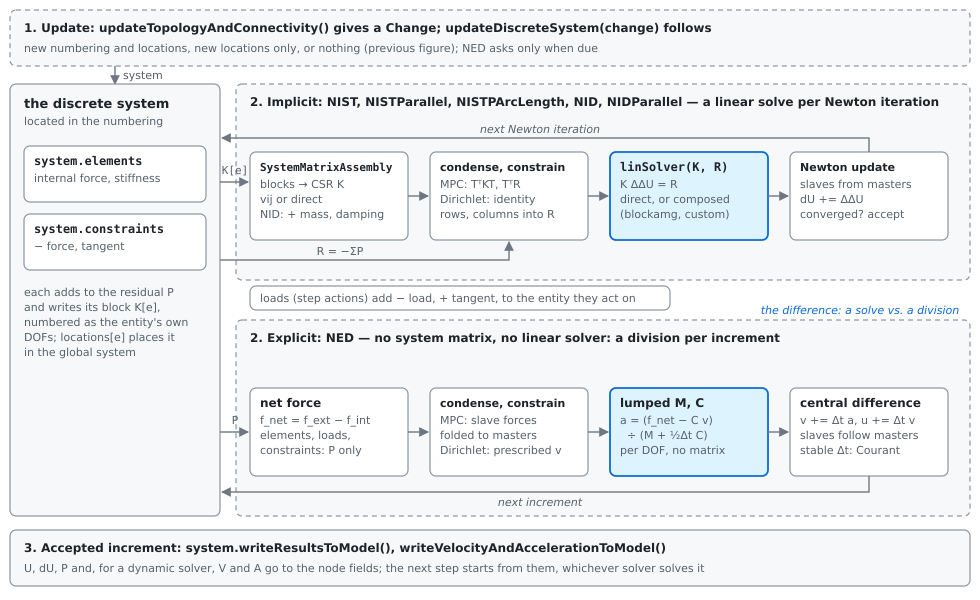
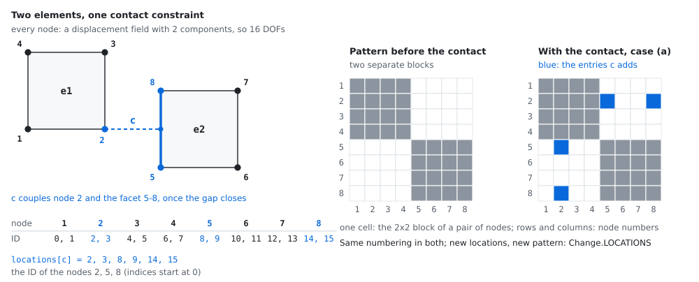
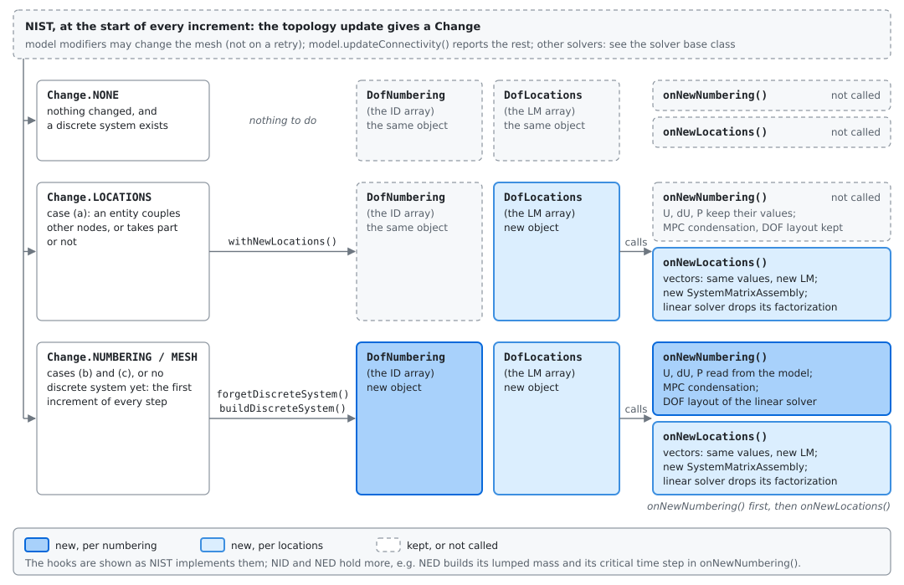
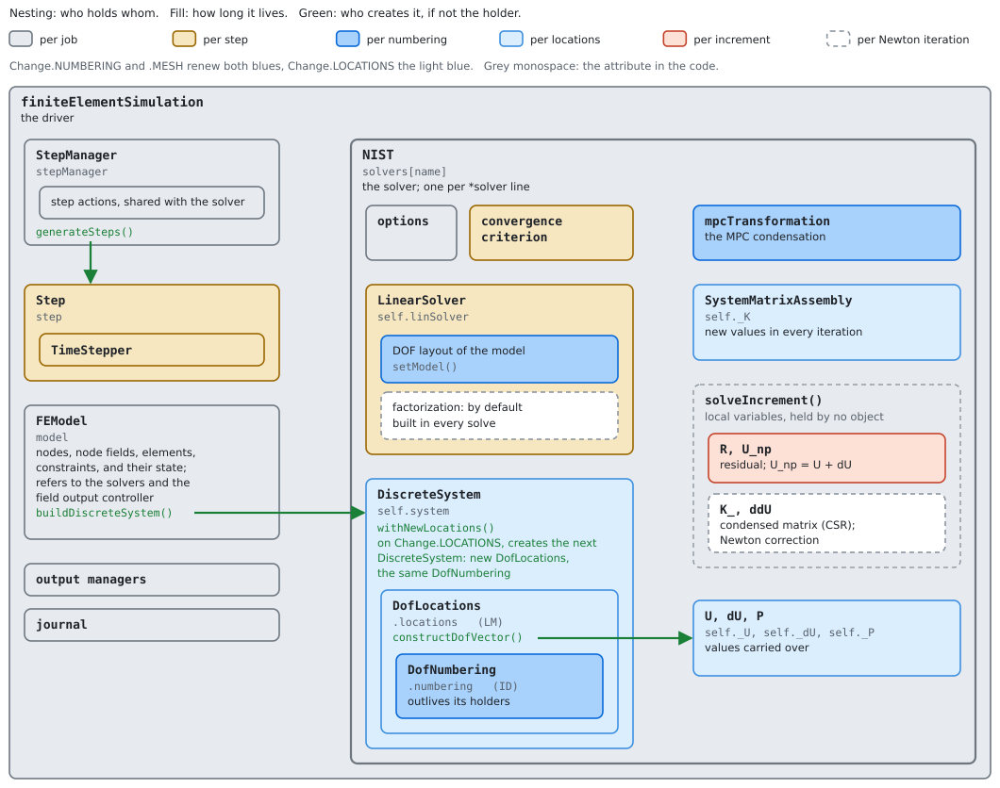

How the parts fit together
==========================

This page is written for students who know the finite element method from a textbook and want to read the code of
EdelweissFE. It follows the textbook procedure and names, at each point, the class and the method that implement it.
The names of the arrays IEN, ID and LM are those of Hughes, *The Finite Element Method*.

The sections build on each other:

#. the three loops of a nonlinear analysis, and the object that runs each of them;
#. the arrays of the textbook and their names in EdelweissFE, with a small example, and where the material law is
   evaluated;
#. what EdelweissFE does differently from the textbook;
#. when the ID and the LM array change during a run, and what the solver rebuilds then;
#. which object holds, creates and discards which other object;
#. the entities that couple nodes: elements and constraints;
#. where to start when adding an element, a material or a solver.

The abbreviations and the names of the solvers are listed at the end (:ref:`architecture-abbreviations`).

.. _architecture-loop:

The three loops
---------------

A nonlinear analysis is divided into steps, e.g., a loading step and an unloading step. Each step is divided into
increments of time, from :math:`t_n` to :math:`t_{n+1}`. In each increment, Newton's method searches for the
increment of the solution :math:`\Delta\boldsymbol{U}` at which the residual vanishes:

.. math::

    \boldsymbol{R}(\Delta\boldsymbol{U}) = \boldsymbol{f}_\mathrm{ext}(t_{n+1})
    - \boldsymbol{f}_\mathrm{int}(\boldsymbol{U}_n + \Delta\boldsymbol{U}) = \boldsymbol{0}.

Each Newton iteration solves the linearized equation :math:`\boldsymbol{K}\,\Delta\Delta\boldsymbol{U} =
\boldsymbol{R}` for the correction :math:`\Delta\Delta\boldsymbol{U}` and adds the correction to
:math:`\Delta\boldsymbol{U}`. The tangent is :math:`\boldsymbol{K} = \partial\boldsymbol{f}_\mathrm{int} / \partial
\boldsymbol{U}`. The residual and the tangent are assembled from the contributions of the elements. If Newton's method
does not converge, the increment is repeated with a smaller time increment; this is called a cutback. The signs of all
contributions are defined in :ref:`residual-and-tangent-convention`.

In EdelweissFE, each loop is run by a different object:

* The **driver** runs the loop over the steps
  (:func:`~edelweissfe.drivers.inputfiledrivensimulation.finiteElementSimulation`).
* The **step** runs the loop over the increments (:meth:`~edelweissfe.steps.base.stepbase.StepBase.solve`). Its time
  stepper proposes the next time increment and reduces it after a failed attempt. The step also triggers the output.
* The **solver** runs the Newton iterations of one increment. The step calls it through five methods: ``beginStep``,
  ``prepareIncrement``, ``attemptIncrement``, ``acceptIncrement`` and ``endStep`` (:doc:`/developer/solverbase`).
* Each **entity**, i.e., each element and each constraint, computes its internal force :math:`\boldsymbol{P}_e` and
  its tangent :math:`\boldsymbol{K}_e` with respect to its own local degrees of freedom. The solver adds both into
  the global system, as in the assembly procedure of the textbook.

The following outline shows these loops for the implicit static solver ``NIST``. Each call is written with its
receiver, as in the code: ``self`` is the object whose method is shown. An indented block shows what a call does
inside. Arguments that do not matter here are abbreviated as ``...``, and methods that only report or measure time are
omitted.

.. code-block:: python

    # finiteElementSimulation, the driver: the loop over the steps
    for step in stepManager.generateSteps(jobInfo, model, ..., solvers, outputManagers):
        step.solve()

    # StepBase.solve: the loop over the increments
    solver.beginStep(step, model, ...)
    while not timeStepper.isFinished():
        solver.prepareIncrement(step, model, isRetry)     # did the ID or the LM array change?
        timeStep = timeStepper.proposeTimeStep()
        try:
            solver.attemptIncrement(step, model, timeStep)    # Newton's method, see below
        except IncrementFailed:
            timeStepper.rejectTimeStep(cutbackFactor)     # cutback, then a retry
            continue
        solver.acceptIncrement(step, model, timeStep)
        timeStepper.acceptTimeStep(timeStep)
        outputManager.finalizeIncrement(...)              # every output manager, if due
    solver.endStep(step, model)

    # NIST.solveIncrement, called by attemptIncrement: the Newton iterations
    while True:
        self.assembleResidualAndTangent(...)              # at U_np = U_n + dU
            for el in self.system.elements:
                el.computeKernels(K[el], Pe, U_np[el], dU[el], time, dT)   # K_e into K[el]
                P[el] += Pe
            self.assembleLoadsAtIncrementEnd(stepActions, ...)        # -f_ext into PLoadsAndConstraints
            for c in self.system.constraints:
                c.computeKernels(U_np[c], dU[c], Pc, K[c], timeStep)
            R = -P - PLoadsAndConstraints                 # R = f_ext - f_int
            R = self.mpcTransformation.transformResidual(R, dU)      # MPC condensation of R
        if iterationCounter == 0:
            self.applyDirichletToResidual(timeStep, R, dirichlets)   # the prescribed increments
        else:
            R[constrainedDofs] = 0.0
            converged, ... = self.checkConvergence(R, ddU, dU, ...)
            if converged:
                break
        K_ = K.assembledMatrix()                          # CSR
        K_ = self.mpcTransformation.transformSystemMatrix(K_)        # MPC condensation of K
        ddU = self.solveForCorrection(K_, R, dirichlets)  # Dirichlet rows, then K_ ddU = R
            ddU = self.linSolver(K_, R)
        dU += ddU                                         # applyCorrection
        iterationCounter += 1

    # NIST.acceptIncrement(step, model, timeStep)
    self.system.writeResultsToModel(U, dU, P)             # into the node fields of the model
    model.advanceToTime(timeStep.totalTime)               # the entities accept their state

``K`` is the system matrix assembly: indexed with an entity, it returns the block of the system matrix the entity writes
into. ``U_np[el]`` returns the values of the vector at the degrees of freedom of the entity. Both are explained in
:ref:`architecture-example`.

The first iteration differs from the later ones. In the first iteration, the residual receives the prescribed
increments of the Dirichlet boundary conditions in their rows, so that the first correction moves the prescribed
degrees of freedom to their new values. From the second iteration on, these rows are set to zero, and the convergence
check follows. Convergence is therefore checked on the residual of the new iterate, before the next linear solve.

The figure summarizes one increment. It also shows the explicit dynamic solver ``NED``, which computes the same
entities but has no Newton loop: with a lumped mass, the equation of motion is solved degree of freedom by degree of
freedom, so ``NED`` holds no system matrix and no linear solver.

         depends on them. Left: the discrete system with its elements and constraints; each computes its internal force
         P_e and tangent K_e, and its location places them in the global system. Implicit lane (NIST, NID and their
         variants), Newton's method: residual and tangent, K_e into K[el], R = f_ext - sum of P_e, the MPC condensation
         of R; then the convergence check: in the first iteration the Dirichlet rows of R receive the prescribed
         increments, later they are zero and R and ddU are checked; if converged, the increment is accepted; otherwise
         solve and update: the MPC condensation of K in CSR format, identity rows for the Dirichlet DOFs, linSolver(K_,
         R) gives ddU, the slaves follow the masters, dU += ddU, and the next Newton iteration computes the entities
         again. Explicit lane (NED, NEDParallel): the net force R = f_ext - sum of P_e, without tangents, the MPC slave
         forces folded into the masters, zero in the Dirichlet rows; the velocity V += dt M^-1 R per DOF with the lumped
         mass, no matrix and no linear solve, the prescribed velocity on Dirichlet DOFs; the position dU = dt V, the
         slaves follow the masters; then the increment is accepted. 3: acceptIncrement writes U, dU, P, V and A to the
         node fields (a quasi-static solver writes V = A = 0), and model.advanceToTime lets the entities accept their
         state; then the step writes the output, and the next increment begins.

   One increment of an implicit solver and of the explicit dynamic solver. Both compute the same entities of the
   discrete system. Blue: where the implicit solvers solve a linear system, the explicit solver divides by a
   diagonal. ``NEST``, the explicit static solver, solves a linear system in every Runge--Kutta stage and is not
   shown. In the code, ``NED`` computes the net force at the end of each increment, for the next one.

.. _architecture-words:

The textbook arrays and their names
-----------------------------------

The assembly procedure of the textbook uses three arrays. EdelweissFE uses the same three under other names, and one
more word for all other sets of indices:

.. list-table::
    :header-rows: 1
    :widths: 10 14 44 32

    * - Textbook
      - EdelweissFE
      - What it is
      - When it changes
    * - IEN
      - connectivity
      - The nodes of an entity, and the fields the entity couples on each node (``entity.nodes``, ``entity.fields``).
      - When a contact constraint couples other nodes, or when the mesh changes.
    * - ID
      - numbering
      - The global index of each degree of freedom of a node field or a scalar variable
        (:class:`~edelweissfe.numerics.dofnumbering.DofNumbering`).
      - When the mesh changes, or when scalar variables, e.g., Lagrange multipliers, are added or removed.
    * - LM
      - locations
      - For each entity, the global indices of its local degrees of freedom: the numbering applied to the
        connectivity (:class:`~edelweissfe.numerics.doflocations.DofLocations`). ``locations[entity]`` is the
        location of one entity.
      - When the connectivity or the numbering changes.
    * -
      - indices
      - Any other set of global indices: the degrees of freedom of a node set, which the numbering holds
        (:meth:`~edelweissfe.numerics.dofnumbering.DofNumbering.locateFieldOnNodeSet`), the degrees of freedom a
        Dirichlet boundary condition prescribes, the slaves of a multi-point constraint.
      - When the numbering changes.

An *entity* is anything that has a location: an element or a constraint (:ref:`architecture-entities`). A location is
a list of indices, never a position in space. The four words have exactly this meaning in the code, in the docstrings
and in this documentation.

Neither the numbering nor the locations are ever changed in place. A change creates a new object
(:doc:`/developer/dofnumbering`).

.. _architecture-example:

Example: numbering and locations
~~~~~~~~~~~~~~~~~~~~~~~~~~~~~~~~

         8, separated by a gap; node 2 faces the middle of the facet 5-8 of e2, and a contact constraint c couples node
         2 with this facet once the gap closes. Below: the ID array, two DOFs per node, node 1: 0, 1 up to node 8: 14,
         15, and the location of c, 2, 3, 8, 9, 14, 15. Middle: the sparsity pattern of the system matrix, one cell per
         pair of nodes, before the contact: two separate blocks, nodes 1 to 4 and nodes 5 to 8. Right: the pattern with
         the contact, case (a): the pairs 2-5, 2-8, 5-2 and 8-2 are added. The numbering is the same in both; the
         locations and the pattern change: Change.LOCATIONS.

   Two elements and a contact constraint. The contact changes the locations and the sparsity pattern of the system
   matrix, case (a), but not the numbering.

The model consists of two four-node elements, ``e1`` and ``e2``, separated by a gap. Each node carries a displacement
field with two components, so the model has 16 degrees of freedom. A contact constraint ``c`` is defined between node 2
and the facet 5--8 of ``e2``. Once the gap is closed, ``c`` couples the nodes 2, 5 and 8.

Each node field occupies a contiguous block of the numbering, ordered node by node
(:class:`~edelweissfe.numerics.dofnumbering.DofNumbering`). If the field lists the nodes in the order 1 to 8, the ID
array reads as follows. The indices start at 0, as all indices in Python do; Hughes starts at 1.

.. list-table::
    :header-rows: 1

    * - node
      - 1
      - 2
      - 3
      - 4
      - 5
      - 6
      - 7
      - 8
    * - ID
      - 0, 1
      - 2, 3
      - 4, 5
      - 6, 7
      - 8, 9
      - 10, 11
      - 12, 13
      - 14, 15

The location of an entity is obtained by applying the numbering to its connectivity
(:class:`~edelweissfe.numerics.doflocations.DofLocations`). It lists the degrees of freedom node by node, and on each
node the fields in the order in which the entity lists them. An entity may reorder this list
(``dofIndicesPermutation``), and the indices of its scalar variables, if it has any, are appended at the end. The LM
array of the example reads:

.. list-table::
    :header-rows: 1

    * - entity
      - connectivity (IEN)
      - location (LM)
    * - ``e1``
      - 1, 2, 3, 4
      - 0, 1, 2, 3, 4, 5, 6, 7
    * - ``e2``
      - 5, 6, 7, 8
      - 8, 9, 10, 11, 12, 13, 14, 15
    * - ``c``, in contact
      - 2, 5, 8
      - 2, 3, 8, 9, 14, 15

A DOF vector indexed with an entity returns the values at the location of the entity, e.g., ``U[e1]``. The system
matrix assembly indexed with an entity returns the block the entity writes into, ``K[e1]``. With these two operations,
the element loop of ``NIST`` (:meth:`~edelweissfe.solvers.nonlinearimplicitstatic.NIST.computeElements`) is a direct
implementation of the assembly procedure of the textbook:

.. literalinclude:: ../../../edelweissfe/solvers/nonlinearimplicitstatic.py
   :language: python
   :pyobject: NIST.computeElements
   :start-after: dT = timeStep.timeIncrement
   :end-before: # the block of the last element
   :dedent: 8

.. _architecture-material:

Where the material law is evaluated
~~~~~~~~~~~~~~~~~~~~~~~~~~~~~~~~~~~

The solver never calls a material. Each element evaluates its material at its quadrature points inside
``computeKernels``. The material receives the deformation over the whole increment, e.g., the strain increment
computed from ``dU[el]``, and the history variables of the last accepted state. It returns the stress, the new history variables and the material
tangent, and the element integrates them into :math:`\boldsymbol{P}_e` and :math:`\boldsymbol{K}_e`. Every Newton
iteration starts again from the accepted history variables. The material therefore always integrates from
:math:`t_n` to :math:`t_{n+1}`, not from the previous iteration.

The element writes the new history variables into a trial buffer. When the increment is accepted,
:meth:`~edelweissfe.models.femodel.FEModel.advanceToTime` calls ``acceptLastState()`` of every element and of every
active constraint, and the trial state becomes the accepted state. A failed increment needs no rollback: the trial
state is overwritten by the next attempt, which starts again from the accepted state. A material that cannot compute
a state, e.g., because its return mapping does not converge, raises a
:class:`~edelweissfe.utils.exceptions.CutbackRequest`, and the step retries the increment with a smaller time
increment.

The elements and materials of Marmot are implemented in C++. EdelweissFE wraps them with Cython
(``edelweissfe.elements.marmotelement``), and the wrapper is used like any other element (:doc:`/model/elements`,
:doc:`/model/materials`).

.. _architecture-differences:

What EdelweissFE does differently from the textbook
---------------------------------------------------

**Every degree of freedom is numbered.** In Hughes, the ID array gives a prescribed degree of freedom the equation
number zero, so that it is not an unknown. EdelweissFE numbers all degrees of freedom, the prescribed ones included.
A Dirichlet boundary condition replaces the row of its degree of freedom by an identity row and moves the column into
the right-hand side (:meth:`~edelweissfe.solvers.nonlinearimplicitstatic.NIST.applyDirichletToStiffness`).
The numbering therefore does not depend on the boundary conditions, and a step may prescribe other degrees of freedom
than the previous step without a new numbering.

**The ID and the LM array may change during a run.** In the textbook, both are set up once, before the analysis. In
EdelweissFE, a contact search may change the LM array between two increments, and a mesh refinement may change both.
:ref:`how-a-change-selects-the-path` explains how the solver follows such a change.

**A discrete system lies between the model and the solver.** The solver does not loop over the elements of the model.
It asks the model for a :class:`~edelweissfe.models.discretesystem.DiscreteSystem`, which contains the numbering, the
locations, the entities that have a location, and the methods that transfer the state between the node fields of the
model and the vectors of the solver. The reason is that the same solvers also solve models that are not made of finite
elements. A meshfree model of EdelweissMeshfree, with background cells, particles and material points, returns a
discrete system derived from this one, and the solvers use it in the same way. The complete list of what a solver
takes from the discrete system is in :ref:`model-discrete-system`.

The model builds a discrete system only if every numbered degree of freedom lies in the location of an entity or is
related to one by a multi-point constraint. Otherwise the degree of freedom would have no row in the system matrix; the
model refuses to build the discrete system and names the node and the field.

**The step runs the loop over the increments.** In many codes, the solver runs the whole analysis. In EdelweissFE, the
step runs the increments, and the solver solves one increment at a time. Consecutive steps may therefore use
different solvers. The state passes from one step to the next through the node fields of the model
(:doc:`/output/nodefieldresults`), so that a step solved by ``NID`` can be followed by a step solved by ``NED``, and
the other way round.

.. _how-a-change-selects-the-path:

When the ID and the LM array change
-----------------------------------

The model reports what changed before an increment as a :class:`~edelweissfe.models.change.Change`. The four values
are ordered: ``NONE < LOCATIONS < NUMBERING < MESH``. In the example of :ref:`architecture-example`, three events are
possible:

.. list-table::
    :header-rows: 1

    * - Event
      - ID
      - LM
      - ``Change``
    * - \(a) the gap closes
      - the same, 16 DOFs
      - a location for ``c``
      - ``LOCATIONS``
    * - \(b) as (a), with a Lagrange multiplier
      - index 16 is added
      - a location for ``c``
      - ``NUMBERING``
    * - \(c) ``e2`` is refined
      - new
      - new
      - ``MESH``

In case (a), ``c`` couples the nodes 2, 5 and 8. No degree of freedom is added, so the numbering is kept. ``c`` obtains
a location, and the sparsity pattern of the system matrix gains the entries marked in blue in the example figure. In
case (b), ``c`` enforces the contact with a Lagrange multiplier. The multiplier is a scalar variable, and scalar
variables are numbered after the node fields: the multiplier obtains the index 16, which is appended to the location
of ``c``. In case (c), the refinement of ``e2`` adds nodes and elements, and both the numbering and the locations are
rebuilt.

Who reports the change
~~~~~~~~~~~~~~~~~~~~~~

At the start of every increment, ``NIST`` runs the topology update
(:meth:`~edelweissfe.solvers.base.nonlinearsolverbase.NonlinearSolverBase.updateTopologyAndConnectivity`). It has two
parts; a retry after a cutback runs only the second:

* The model modifiers may change the mesh, e.g., a mesh refinement (:doc:`/developer/topologypipeline`). The objects
  that depend on the mesh, such as a tie or a contact surface, then update themselves.
* The model brings the connectivity of its entities up to date, e.g., a contact constraint searches for the surface it
  touches now. The model collects what its entities report and answers with ``NONE``, ``LOCATIONS`` or ``NUMBERING``
  (:meth:`~edelweissfe.models.femodel.FEModel.updateConnectivity`).

The result is ``MESH`` if the mesh changed, and otherwise the answer of the model. The other solvers run the topology
update less often; see :ref:`solver-discrete-system-updates`.

What the solver rebuilds
~~~~~~~~~~~~~~~~~~~~~~~~

         modifiers may change the mesh, except on a retry, and model.updateConnectivity() reports the rest; the other
         solvers are listed on the page of the solver base class. Row 1, Change.NONE with an existing discrete system:
         the DofNumbering and the DofLocations are the same objects, and no hook is called. Row 2, Change.LOCATIONS,
         case (a): withNewLocations() keeps the DofNumbering and creates new DofLocations; onNewNumbering() is not
         called, so U, dU and P keep their values and the MPC condensation and the DOF layout of the linear solver are
         kept; onNewLocations() wraps the vectors with the new locations, creates a new SystemMatrixAssembly, and the
         linear solver drops its factorization. Row 3, Change.NUMBERING or MESH, cases (b) and (c), or no discrete
         system yet: forgetDiscreteSystem() and buildDiscreteSystem() create a new DofNumbering and new DofLocations;
         onNewNumbering() reads U, dU, P from the model, builds the MPC condensation and the DOF layout of the linear
         solver, then onNewLocations() follows. Dark blue: new per numbering; light blue: new per locations; grey and
         dashed: kept, or not called.

   What the solver rebuilds for each ``Change``. The middle row is case (a), the bottom row cases (b) and (c). The
   colours are those of the figure in :ref:`architecture-objects`: dark blue is new per numbering, light blue new per
   locations, grey and dashed kept or not called.

Every solver follows the change through the same method,
:meth:`~edelweissfe.solvers.base.nonlinearsolverbase.NonlinearSolverBase.updateDiscreteSystem`, in the same notation as
in :ref:`architecture-loop`:

.. code-block:: python

    # NIST.beginStep(step, model, ...)
    self.selectLinearSolverForStep()                      # a new linSolver, unless the step uses the same one
    self.convergenceCriterion = self.createConvergenceCriterion()
    self.forgetDiscreteSystem()                           # built again in the first increment

    # NIST.prepareIncrement(step, model, isRetry): what changed?
    self._change = self.updateTopologyAndConnectivity(model, step, ...)    # -> a Change
        meshChanged = model.topology.update(step) if not isRetry else False    # model modifiers
        change = model.updateConnectivity()               # e.g. a contact search
        return Change.MESH if meshChanged else change

    # NIST.attemptIncrement(step, model, timeStep)
    self.updateDiscreteSystem(model, self._change)
        if self.system is not None and change == Change.NONE:
            return
        if self.system is None or change >= Change.NUMBERING:
            self.forgetDiscreteSystem()
            self.system = model.buildDiscreteSystem()     # the model creates:
                # numbering = DofNumbering(nodeFields, scalarVariables, nodeSets)        # ID
                # locations = DofLocations(numbering, elements, constraints)            # LM
                # return DiscreteSystem(model, locations)
            self.onNewNumbering()                         # what lives per numbering
                self.linSolver.setModel(model, self.system.numbering)
                self._U = self.system.locations.constructDofVector()     # also dU, P
                self.system.readStateFromModel(self._U)
                self.mpcTransformation = MultiPointConstraintTransformation(records, nDof)
        elif change == Change.LOCATIONS:
            self.system = self.system.withNewLocations()  # new LM, same ID
        self.onNewLocations()                             # what lives per locations
            self._U = self._U.onLocations(self.system.locations)        # also dU, P
            self.linSolver.onNewMatrixPattern()
            self._K = SystemMatrixAssembly(self.system.locations, nWorkers, patternFillIn)
    self.solveIncrement(self._U, self._dU, self._P, self._K, step.actions, model, timeStep, ...)

The two hooks sort the objects of a solver by what they are derived from. Both are declared in the base class and
implemented by every solver:

``onNewNumbering()``
    Builds the objects that are sized by the numbering: the vectors ``U``, ``dU`` and ``P``, whose values are read
    from the model; the DOF layout of the linear solver (``setModel``); the layout of the convergence table; and the
    MPC condensation, which is reconciled with the Dirichlet boundary conditions of the step.

``onNewLocations()``
    Builds the objects that are derived from the locations. The vectors are wrapped with the new locations; their
    values are kept without a copy (:meth:`~edelweissfe.numerics.dofvector.DofVector.onLocations`). The linear
    solver discards what it built for the old sparsity pattern, e.g., a factorization or a multigrid hierarchy
    (:meth:`~edelweissfe.linsolve.base.LinearSolver.onNewMatrixPattern`). A new system matrix assembly is created with
    the sparsity pattern of the new locations.

Before a new numbering, the solver discards its old discrete system (``forgetDiscreteSystem``). The base class
discards the discrete system and the MPC condensation; each solver extends the method by the other objects it holds,
e.g., ``NIST`` its vectors and its system matrix assembly. The old and the new objects therefore never exist at the
same time.

The split into two hooks matters because a contact search may change the locations in many increments. On new
locations, only the objects that depend on the sparsity pattern are rebuilt. The vectors keep their values, and the
MPC condensation and the DOF layout of the linear solver are kept. ``NID`` keeps its mass and damping on new locations
and copies the mass into the new system matrix assembly; only with ``inertia=nodes`` does it assemble the lumped mass
of the entities that integrate their own inertia anew in every increment.

Only a change of the mesh moves or creates nodes. After a refinement, the state transferred to the new mesh is in
general not in equilibrium. With the option ``equilibrateAfterModelChange``, ``NIST`` first restores equilibrium at
the last converged load, in an increment of zero length, and then advances the load.

.. _architecture-objects:

Holder, lifetime and creator of the objects
-------------------------------------------

         shows how long an object lives: per job, per step, per numbering, per locations, per increment or per Newton
         iteration. The driver, finiteElementSimulation, holds the StepManager with the step actions, the current
         Step with its TimeStepper, the FEModel with nodes, node fields, elements and constraints, the output
         managers, the journal, and the solver. The solver holds its options (per job), its convergence criterion and
         its LinearSolver (per step), the multi-point-constraint condensation (per numbering), the
         SystemMatrixAssembly and the vectors U, dU, P (per locations, the values carried over), and its
         DiscreteSystem (per locations), which holds the DofLocations (per locations), which hold the DofNumbering
         (per numbering): the numbering outlives its holders. The LinearSolver holds the DOF layout of the model (per
         numbering) and its factorization (by default per iteration). The local variables of solveIncrement are R and
         U_np (per increment) and the condensed matrix K_ and the correction ddU (per iteration). Green: the creator,
         where it is not the holder: the StepManager creates each Step (generateSteps), the FEModel creates the
         DiscreteSystem (buildDiscreteSystem), the DiscreteSystem creates its successor (withNewLocations), and the
         DofLocations create the vectors (constructDofVector).

   The objects of a run with ``NIST``. A box holds the boxes inside it. The fill shows how long an object lives, i.e.,
   upon which event it is created again. Grey monospace: the attribute in the code. Green: the method that creates an
   object whose creator is not its holder. Click the figure to enlarge it.

The figure combines three relations.

**Nesting shows ownership.** A box contains the objects it holds a reference to. For example, the solver holds its
discrete system as ``self.system``, the discrete system holds its locations as ``.locations``, and the locations hold
the numbering as ``.numbering``; the pseudocode in :ref:`architecture-loop` uses this path. The dashed frame
``solveIncrement()`` is an exception: it contains the local variables of the Newton loop, which no object holds.

**The fill shows the lifetime.** A holder and the objects it holds may live for different times, in both directions.
The linear solver lives for a step, but by default builds its factorization again in every Newton iteration. The
numbering outlives the locations and the discrete system that hold it, because ``withNewLocations`` passes it on to
their successors.

**Green shows the creator, where it is not the holder.** Usually an object is created by its holder. There are four
exceptions. The step manager creates each step, and the driver holds the step while it is solved. The model creates the
discrete system together with its locations and its numbering, and the solver holds it. The discrete system creates its
successor when only the locations change. The locations create the vectors (``constructDofVector``), and the solver
holds them.

The ``Change`` of :ref:`how-a-change-selects-the-path` rebuilds the objects of its lifetime and all shorter-lived ones:

* ``LOCATIONS`` rebuilds the light blue objects: the discrete system, the locations, the system matrix assembly and
  the vectors, which keep their values. The linear solver discards what it built for the old sparsity pattern.
* ``NUMBERING`` and ``MESH`` also rebuild the dark blue objects: the numbering, the MPC condensation and the DOF layout
  of the linear solver. The vectors are created again and read their values from the model.
* ``NONE`` rebuilds nothing, once a discrete system exists. The first increment of a step always builds one.

The discrete system lives for at most one step. ``beginStep`` discards it, and the first increment of the step builds
it again, because the MPC condensation is reconciled with the Dirichlet boundary conditions of the step.

From the input file to the objects
~~~~~~~~~~~~~~~~~~~~~~~~~~~~~~~~~~

The driver, :func:`~edelweissfe.drivers.inputfiledrivensimulation.finiteElementSimulation`, reads the input file and
creates the objects of the figure. The keywords of the example input file of the start page
(``examples/CantileverBeam/test3D.inp``) map to the objects as follows:

.. list-table::
    :header-rows: 1
    :widths: 26 40 34

    * - Keyword
      - Object
      - Created by, held by
    * - ``*job``
      - the job information, and a default solver
      - the driver
    * - ``*node``, ``*element``, ``*nSet``, ``*elSet``, ``*modelGenerator``
      - nodes, node fields, elements, sets
      - the :class:`~edelweissfe.generators.abqmodelconstructor.AbqModelConstructor` and the model generators; held
        by the model
    * - ``*material``, ``*section``
      - the materials, which the sections assign to the elements
      - the ``AbqModelConstructor``; held by the model and the elements
    * - ``*constraint``
      - constraints
      - the ``AbqModelConstructor``; held by the model
    * - ``*solver``
      - a solver
      - the driver; also known to the model as ``model.solvers``
    * - ``*linearSolver``
      - the definition of a linear solver
      - the driver; the solver creates the linear solver from it when a step begins
    * - ``*step`` and its ``>>`` lines
      - a step; step actions such as ``>>dirichlet``, ``>>nodeforces``, ``>>options``
      - the step manager
    * - ``*fieldOutput``
      - the field output controller
      - the driver; also known to the model
    * - ``*output``
      - an output manager
      - the driver; also known to the model as ``model.outputManagers``

The model refers to the solvers and the output managers so that an ``>>options`` line of a step can find the object it
modifies. The step manager creates the step actions when the first step that defines them is due, and updates them
when a later ``*step`` redefines them. The step and the solver refer to the same step actions. The step manager creates
each step when it is due, and each step creates its time stepper.

The solver creates the objects it iterates on:

* once: its options. An ``>>options`` line of a step changes them for the remaining steps. The parameters of the
  increment loop, such as the maximum number of iterations, belong to the step.
* when a step begins: the linear solver, unless the step uses the same one as the previous step, and the convergence
  criterion.
* on a new numbering: the vectors ``U``, ``dU`` and ``P``, the MPC condensation, and the DOF layout of the linear
  solver.
* on new locations: the system matrix assembly, and the vectors wrapped with the new locations.
* in every increment: the residual ``R`` and the trial solution ``U_np``.
* in every Newton iteration: new values of the system matrix, the condensed system matrix ``K_`` in CSR format, the
  correction ``ddU`` and, by default, the factorization or the multigrid hierarchy of the linear solver.

The classes in the figure
~~~~~~~~~~~~~~~~~~~~~~~~~

:class:`~edelweissfe.models.femodel.FEModel`
    The mesh and its data: the nodes, the node fields, the elements, the constraints, the multi-point constraints,
    and the topology pipeline that changes the mesh during a run (:doc:`/developer/models`). It holds the
    connectivity of its entities and builds the discrete system on request.

:class:`~edelweissfe.models.discretesystem.DiscreteSystem`
    What a solver needs from the model: the numbering, the locations, the elements and the constraints that have a
    location, and the transfer of the state between the node fields and the vectors
    (:meth:`~edelweissfe.models.discretesystem.DiscreteSystem.readStateFromModel`,
    :meth:`~edelweissfe.models.discretesystem.DiscreteSystem.writeResultsToModel`).

:class:`~edelweissfe.numerics.dofnumbering.DofNumbering`
    The numbering: the node fields, each in a contiguous block, then the scalar variables. It also holds the indices
    of the node sets and reads and writes the node fields. The locations, the MPC condensation, the linear solver,
    the Dirichlet boundary conditions and the output all use the same numbering.

:class:`~edelweissfe.numerics.doflocations.DofLocations`
    The locations of all entities of the discrete system. It creates the DOF vectors that refer to it. It is a class
    of its own because it lives shorter than the numbering: a contact search creates new locations in many
    increments.

The solver
    Everything it iterates on: the vectors ``U``, ``dU``, ``P`` (and the velocity and the acceleration of a dynamic
    solver); the system matrix assembly, which is filled in every Newton iteration on one of two paths, ``vij`` or
    ``direct`` (:ref:`system-matrix-assembly`); and the MPC condensation
    (:class:`~edelweissfe.numerics.mpctransformation.MultiPointConstraintTransformation`). The solver, not the
    discrete system, builds the MPC condensation, because the condensation is reconciled with the Dirichlet boundary
    conditions of the step, which the model does not know
    (:class:`~edelweissfe.solvers.base.nonlinearsolverbase.NonlinearSolverBase`).

The linear solver
    One interface for every linear solver (:doc:`/analysis/linsolvers`). On a new numbering, the solver passes it the
    model and the numbering (:meth:`~edelweissfe.linsolve.base.LinearSolver.setModel`). A field-split solver takes
    the field blocks from them, and an algebraic multigrid solver the node coordinates for the near-null space. A
    composed linear solver (:doc:`/analysis/composedlinsolvers`) needs this information, which a bare matrix does not
    carry.

The figure shows ``NIST``. ``NID`` holds the same objects, and in addition the velocity, the acceleration, the mass
matrix and the lumped damping. ``NEST`` is derived from ``NIST`` and holds the same objects, but builds its discrete
system once per step, in ``beginStep``. ``NED`` holds no linear solver and no system matrix assembly. It holds the
lumped mass per numbering and solves no system of equations.

.. _architecture-entities:

The entities that couple nodes
------------------------------

The discrete system locates two kinds of entity, and locates both in the same way:

* The **elements** (and, in a meshfree model, the cells and the particles) follow the protocol of
  :class:`~edelweissfe.nodecouplingentity.base.nodecouplingentity.BaseNodeCouplingEntity`: they state their nodes,
  and the fields they couple on each node. The Python elements derive from this class. The Cython wrappers of the
  Marmot elements implement the same protocol without deriving from it, because a Cython extension type cannot derive
  from a Python class.
* The **constraints** (:doc:`/model/constraints`) state their nodes and fields in the same way. Unlike elements, they
  may change them between increments (``updateConnectivity``).

The protocol describes only the location. What an entity computes depends on its kind. Every located entity adds to
the residual and writes into its own block of the system matrix, in its own local numbering of its degrees of freedom
(:class:`~edelweissfe.numerics.systemmatrixcontributor.SystemMatrixContributorBase`). Its location maps this local
numbering into the global system. The assembly, the solver and the locations therefore never need to know what kind of
entity they handle: a contact constraint and a hexahedral element are added in the same way.

The **loads** of a step are not located entities. A load is a step action
(:class:`~edelweissfe.stepactions.base.loadbase.LoadBase`): it has no location and is not held by the discrete system.
It adds to the residual, and to the tangent if it follows the deformation, in the block of the entity it acts on
(:doc:`/analysis/stepactions`).

The signs of all contributions, from elements, loads and constraints, are defined in
:ref:`residual-and-tangent-convention`.

.. _architecture-extending:

Where to start when adding something
------------------------------------

* **A material**: a constitutive model for production use belongs in Marmot (``modules/materials``); EdelweissFE also
  has its own Python materials (``edelweissfe/materials``), which are easier to read and to debug. A new keyword or a
  new type name is registered as described in :doc:`/developer/inputsystem`; see also :doc:`/model/materials`.
* **An element**: derive from :class:`~edelweissfe.elements.base.baseelement.BaseElement`. It computes
  :math:`\boldsymbol{P}_e` and :math:`\boldsymbol{K}_e` in ``computeKernels``, keeps its trial state until
  ``acceptLastState()``, and states its nodes and fields for its location. See :doc:`/model/elements`.
* **A constraint**: see :doc:`/model/constraints`, and :ref:`residual-and-tangent-convention` for the signs.
* **A solver**: derive from :class:`~edelweissfe.solvers.base.nonlinearsolverbase.NonlinearSolverBase` and implement
  the two hooks ``onNewNumbering`` and ``onNewLocations`` for the objects it holds (:doc:`/developer/solverbase`).

.. _architecture-abbreviations:

Abbreviations and solver names
------------------------------

BC
    Boundary condition. Dirichlet boundary conditions and loads are step actions (:doc:`/analysis/stepactions`).
CSR
    Compressed sparse row: the storage format of the system matrix (:doc:`/developer/assembly`).
DOF
    Degree of freedom.
IEN, ID, LM
    The element nodes array, the destination array and the location matrix of Hughes. In EdelweissFE: the
    connectivity, the numbering and the locations (:ref:`architecture-words`).
MPC
    Multi-point constraint: slave degrees of freedom expressed by master degrees of freedom, e.g., ties and hanging
    nodes. The MPC condensation eliminates the slaves from the system
    (:class:`~edelweissfe.numerics.mpctransformation.MultiPointConstraintTransformation`, attribute
    ``mpcTransformation``).
VIJ
    Values with their row and column indices (coordinate format): the default assembly path
    (:doc:`/developer/assembly`).
NIST, NID
    Nonlinear Implicit STatic and Nonlinear Implicit Dynamic (Newmark) solver: one linear solve per Newton iteration
    (:doc:`/analysis/solvers`).
NEST, NED
    Nonlinear Explicit STatic (Runge--Kutta) and Nonlinear Explicit Dynamic (central difference, lumped mass) solver
    (:doc:`/analysis/solvers`).

The suffix ``Parallel`` marks the variant that computes the elements on all threads; the constraints are still
computed one after the other. ``NISTPArcLength`` is the parallel arc length variant of ``NIST``.
