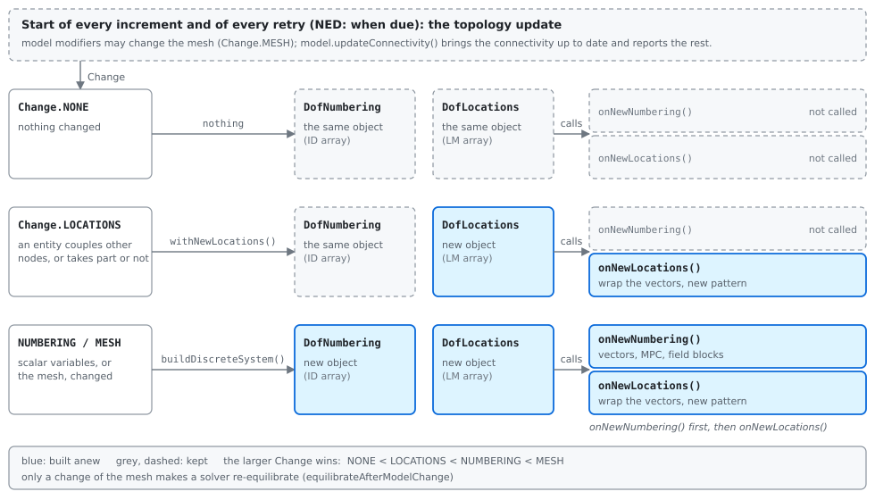
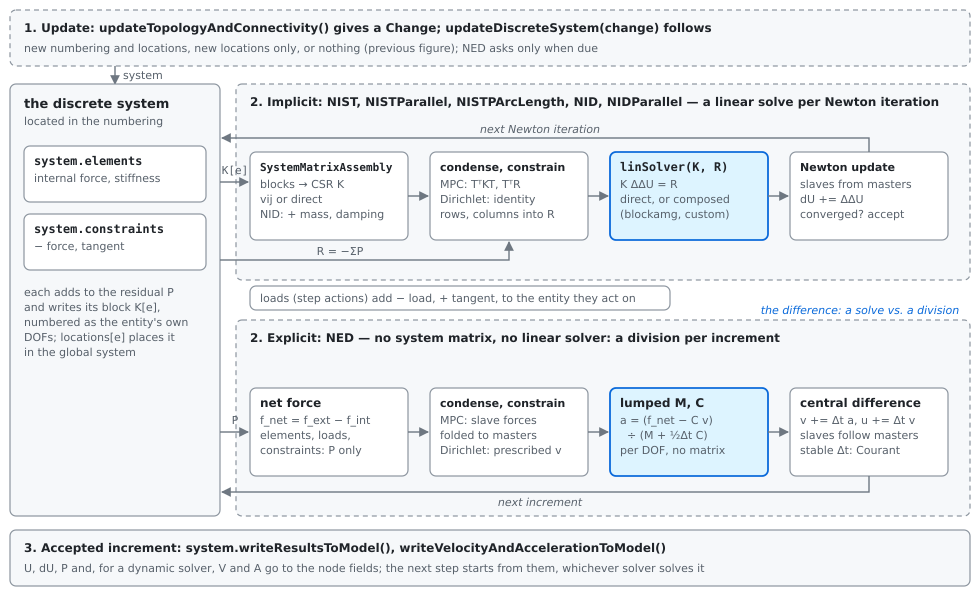

How the parts fit together
==========================

A simulation is driven by a solver acting on a model. This page shows the objects between the two -- the discrete
system and its two parts, the numbering and the locations of the degrees of freedom, the entities that couple nodes,
the system matrix assembly, the multi-point-constraint condensation and the linear solver -- what each one holds, who
builds it, how a change of the model reaches the solver, and why the boundaries are where they are. The pages linked
from each section have the details.

.. _architecture-words:

The words
---------

Four words name four different things, and are used in exactly this meaning in the code, the docstrings and these
pages:

* the **connectivity** of an entity: which nodes it touches (for a contact constraint: which it couples now). It is
  the *IEN* array of the textbooks, and belongs to the entities of the model;
* the **numbering** of the degrees of freedom: the global index of every degree of freedom of a node field or a scalar
  variable. It is the *ID* array, except that every degree of freedom is numbered, a prescribed one included;
* the **location** of an entity: the global indices of the entity's local degrees of freedom, ``locations[entity]``.
  It is the *LM* array -- the numbering applied to the connectivity -- and never a position in space;
* **indices**: any other set of global indices -- a node set's, the Dirichlet degrees of freedom, the slaves of a
  multi-point constraint -- which whoever uses them holds.

The numbering changes with the mesh, and when scalar variables (e.g. the Lagrange multipliers of constraints) enter or
leave. The locations change when the connectivity changes: a contact search couples other nodes, and the numbering
stays. Each has its own object, and neither is ever changed in place: a change makes a new one
(:doc:`/developer/dofnumbering`).

What each part holds
--------------------

``FEModel``
    The mesh and its data: the node fields, the elements, the constraints, the multi-point constraints, and the
    topology pipeline that changes the mesh during a run (:class:`~edelweissfe.models.femodel.FEModel`,
    :doc:`/developer/models`). It owns the connectivity of its entities, and classifies what they report
    (:meth:`~edelweissfe.models.femodel.FEModel.updateConnectivity`); a change of the mesh is what its topology
    update reports (see below). It knows nothing about solvers.

``DiscreteSystem``
    What the model says its system is made of (:class:`~edelweissfe.models.discretesystem.DiscreteSystem`, built by
    :meth:`~edelweissfe.models.femodel.FEModel.buildDiscreteSystem`): the numbering, the locations, the elements and
    constraints that have a location, the entities whose inertia is assembled element by element
    (:attr:`~edelweissfe.models.discretesystem.DiscreteSystem.elementsWithNodalInertia`), the model the linear solver
    is set up for, and how the state passes between
    the model's node fields and the solver's vectors
    (:meth:`~edelweissfe.models.discretesystem.DiscreteSystem.readStateFromModel`,
    :meth:`~edelweissfe.models.discretesystem.DiscreteSystem.writeResultsToModel`). **Why a discrete system, not a
    model the solver looks into:** the same solvers solve models that are not made of finite elements. A meshfree
    model of EdelweissMeshfree, with background cells, particles, material points and degrees of freedom that live
    for one increment only, returns a discrete system derived from this one; the solver calls it the same way.
    The full list of what a solver takes from it is in :ref:`model-discrete-system`. The model builds it only if every
    numbered degree of freedom is in the location of an entity, or related by a multi-point constraint: a degree of
    freedom that no located entity touches would have no row in the system matrix, and is refused when the discrete
    system is built, naming the node and the field.

``DofNumbering``
    The numbering, and nothing about the entities
    (:class:`~edelweissfe.numerics.dofnumbering.DofNumbering`): the node fields, each one a contiguous block, then the
    scalar variables; the indices of node sets; the reading and writing of node fields. **Why:** one numbering, read
    by everything else -- the locations, the condensation, the linear solver's field blocks, the Dirichlet boundary
    conditions and the output.

``DofLocations``
    The numbering applied to the connectivity (:class:`~edelweissfe.numerics.doflocations.DofLocations`): for every
    entity of the discrete system, the global indices of its local degrees of freedom. It builds the DOF vectors
    that refer to it. **Why separate from the numbering:** the two have different lifetimes. A contact search makes
    new locations on many increments; everything that is sized by the numbering is then left alone.

The solver
    Everything it iterates on: the vectors ``U``, ``dU``, ``P`` (and the velocity and the acceleration of a dynamic
    solver); the ``SystemMatrixAssembly`` with its CSR pattern, derived from the locations and filled in every Newton
    iteration on one of two paths, ``vij`` or ``direct`` (:ref:`system-matrix-assembly`); and the condensation of the
    multi-point constraints (ties, hanging nodes) into their masters
    (:class:`~edelweissfe.numerics.mpctransformation.MultiPointConstraintTransformation`), whose pattern fill-in enters
    the pattern of the assembly. **Why the solver builds the condensation, not the discrete system:** it is
    reconciled against the Dirichlet boundary conditions of the step, which the model does not know. Each of these
    belongs to the object it is derived from: what is sized by the numbering is dropped and built anew with a new
    numbering, the pattern of the assembly with every new locations, and never the old and the new one at once
    (:class:`~edelweissfe.solvers.base.nonlinearsolverbase.NonlinearSolverBase`).

The linear solver
    One adapter for every linear solver (:doc:`/analysis/linsolvers`). A new numbering gives it the model and the
    numbering (:meth:`~edelweissfe.linsolve.base.LinearSolver.setModel`), from which a field-split solver takes the
    field blocks, and the near-null-space its node coordinates; new locations tell it that the sparsity pattern
    changes (:meth:`~edelweissfe.linsolve.base.LinearSolver.onNewMatrixPattern`), so that it drops what it built for
    the old pattern. **Why:** a composed solver (:doc:`/analysis/composedlinsolvers`) needs the physics of the blocks,
    which a bare matrix does not carry. The linear solver itself is kept from step to step while the step names the
    same one.

.. _how-a-change-selects-the-path:

How a change selects the path
-----------------------------

This section is the one telling of the mechanism; the docstrings of
:class:`~edelweissfe.solvers.base.nonlinearsolverbase.NonlinearSolverBase` (:doc:`/developer/solverbase`) are its
contract, and the pages on solvers, constraints and models link here.

         stay, and no hook is called. Change.LOCATIONS: withNewLocations gives the same DofNumbering and a new
         DofLocations, and only onNewLocations is called. Change.NUMBERING or Change.MESH: buildDiscreteSystem gives a
         new DofNumbering and a new DofLocations, and onNewNumbering, then onNewLocations, are called.

   What the topology update reports selects what is built anew: blue is a new object or a hook that is called, grey is
   kept.

At the start of every increment, and of every retry after a cutback, the implicit solvers run the topology update
(:meth:`~edelweissfe.solvers.base.nonlinearsolverbase.NonlinearSolverBase.updateTopologyAndConnectivity`); ``NED``
runs it when it is due (see the table below). The model modifiers may change the mesh
(:doc:`/developer/topologypipeline`), the mesh-dependent consumers (a tie or contact surface) catch up on it, and the
model brings the connectivity of its entities up to date, e.g. a contact constraint searches for the surface it now
touches. The answer is one :class:`~edelweissfe.models.change.Change`, the same for every solver, ordered
``NONE < LOCATIONS < NUMBERING < MESH``. **Who classifies:** the model classifies what its entities report
(:meth:`~edelweissfe.models.femodel.FEModel.updateConnectivity` gives ``NONE``, ``LOCATIONS`` or ``NUMBERING``), and
``MESH`` is what the topology update reports: the solver base class takes it if a model modifier changed the mesh, or
if a mesh-dependent consumer caught up on a changed mesh (it refreshes only when nodes or elements did change), and
otherwise the answer of the model.

Every solver then goes through one build path
(:meth:`~edelweissfe.solvers.base.nonlinearsolverbase.NonlinearSolverBase.updateDiscreteSystem`), which writes the
journal lines about it, and only the change decides:

``NONE``
    Nothing happens: the discrete system stands (it is built, if the solver has none yet).

``LOCATIONS``
    An entity couples other nodes, or takes part or not (a contact constraint paired anew, or leaving reach). The
    numbering stands: the discrete system makes new locations on it
    (:meth:`~edelweissfe.models.discretesystem.DiscreteSystem.withNewLocations`), and only ``onNewLocations()``
    follows.

``NUMBERING``
    The degrees of freedom to be numbered changed: the scalar variables of the active constraints, e.g. a constraint
    with Lagrange multipliers left reach; in a meshfree model, also the nodes of the active domain. The solver drops
    what it holds (``forgetDiscreteSystem()``), the model builds a new discrete system, and ``onNewNumbering()`` and
    then ``onNewLocations()`` follow.

``MESH``
    As ``NUMBERING``, and the mesh changed, e.g. by h-adaptivity. The solver re-equilibrates, if asked
    (``equilibrateAfterModelChange``): the state of the model is then not the state the solver carries. Only a change
    of the mesh does so, as a change of the locations or of the numbering moves no node and creates none.

The solver base class declares the hooks, and each solver implements them; both are abstract. They sort what a solver
holds by what it is derived from:

``onNewNumbering()``
    Everything that is sized by the numbering: the vectors, which the state is read into from the model; the linear
    solver's view of the degrees of freedom; the layout of the convergence table; the multi-point-constraint
    condensation; and, in ``NED``, the lumped operators, the classification of the fields by time derivative and the
    stable time increment. ``NID`` has no such hook of its own: its mass and damping are dropped with the discrete
    system (``forgetDiscreteSystem()``) and assembled by its first increment on the new one.

``onNewLocations()``
    Everything that is derived from the locations: the vectors are wrapped with them, their values kept, without a
    copy (:meth:`~edelweissfe.numerics.dofvector.DofVector.onLocations`); the linear solver learns of a new pattern
    (:meth:`~edelweissfe.linsolve.base.LinearSolver.onNewMatrixPattern`) and drops what it built for the old one, a
    hierarchy or a factorization; the system matrix assembly is built with the pattern the locations determine, and,
    in ``NID``, the mass is copied onto it. ``NED`` has no system matrix, and wraps its vectors only.

Nothing sized by the numbering is touched by new locations: the lumped mass of ``NED`` is a function of the elements
and of the numbering, and a contact search does not reassemble it. A contact search is much narrower than it looks: it
touches no node, no field, no scalar variable and no element, so no operator that is a function of these changes.

**Why two hooks, and one path:** a contact search changes the locations on many increments, and must not pay for what
the numbering decides; and no solver needs its own test of what it may reuse -- the model classifies what its entities
report, the discrete system never changes in place, and the hooks say what depends on what. The restart checkpoint
holds the digest of the numbering its vectors belong to (:doc:`/developer/restart`).

Two solvers ask less often. ``NED`` runs the topology update at the start of its step and after every
``topology-check-frequency``-th increment, and, every ``contact-update-frequency``-th increment, calls
:meth:`~edelweissfe.models.femodel.FEModel.updateConnectivity` alone; this can only be answered with new locations, as
``NED`` refuses constraints with scalar variables. It asks only if a constraint of the model searches as the bodies
move
(:attr:`~edelweissfe.nodecouplingentity.base.nodecouplingentity.BaseNodeCouplingEntity.connectivityChangesWithMotion`,
e.g. a contact); the same attribute makes ``NEST``, which never updates the connectivity, refuse such a constraint.
``NIST`` judges its prediction once per increment, right after the update
(:meth:`~edelweissfe.solvers.nonlinearimplicitstatic.NIST.predictionSurvives`): it survives new locations on the same
numbering by construction, but is extrapolated across a change of the connectivity only with
``extrapolateAcrossConnectivityChange``; it survives a new numbering only if the new one numbers the degrees of
freedom as before, and a change of the mesh never.

.. _architecture-entities:

The entities that couple nodes
------------------------------

The discrete system locates two kinds of entity, and locates both the same way, whatever it is:

* the **elements** -- and, in a meshfree model, the cells and the particles -- follow the protocol of
  :class:`~edelweissfe.nodecouplingentity.base.nodecouplingentity.BaseNodeCouplingEntity`: their nodes, and the fields
  they couple on each node. The Python entities derive from it; the compiled Marmot wrappers implement the same
  protocol without deriving, because a Cython extension type cannot derive from a Python class;
* the **constraints** (:doc:`/model/constraints`) state their nodes and fields in the same way, and may change them
  between increments (``updateConnectivity``).

The protocol is the location, and only the location: what an entity computes is the business of its kind. The inertia
and the damping, for example, are reported by finite elements, not by the protocol, and it is the discrete system that
names the entities a solver asks for them at the nodes
(:attr:`~edelweissfe.models.discretesystem.DiscreteSystem.elementsWithNodalInertia`: in a finite element model the
elements, in a meshfree model the finite elements only). The inertia of the particles, which integrate their own, is
their own mass (``computeLumpedInertia``), lumped at the nodes by
:meth:`~edelweissfe.models.discretesystem.DiscreteSystem.assembleLumpedMassOfEntitiesWithOwnInertia`.

Every located entity writes into the residual and into its own block of the system matrix, in its own numbering of its
degrees of freedom (:class:`~edelweissfe.numerics.systemmatrixcontributor.SystemMatrixContributorBase`); its location
places that numbering in the global system. **Why:** the assembly, the solver and the locations never ask what kind of
entity they deal with. A contact constraint and a hexahedral element are added the same way; a block that couples only
a part of its degrees of freedom lists its entries, and is still added the same way.

The **loads** of the step are not located entities: a load is a step action
(:class:`~edelweissfe.stepactions.base.loadbase.LoadBase`) that has no location and is not held by the discrete
system. It adds to the residual, and to the tangent if it follows the deformation, into the block of the entity it acts
on (:doc:`/analysis/stepactions`). The rule every contribution follows -- residual and tangent, and their signs -- is
:ref:`residual-and-tangent-convention`.

.. _model-discrete-system:

What the solver takes from the discrete system
----------------------------------------------

A solver solves; what its system is made of, the model says. The solver keeps the discrete system it got from
:meth:`~edelweissfe.models.femodel.FEModel.buildDiscreteSystem` until the next rebuild, or until new locations on the
same numbering replace it, and takes from it:

* the numbering of the degrees of freedom (:attr:`~edelweissfe.models.discretesystem.DiscreteSystem.numbering`),
  which also locates the degrees of freedom of a field on a node set, those a Dirichlet boundary condition prescribes
  or a node force loads (:meth:`~edelweissfe.numerics.dofnumbering.DofNumbering.locateFieldOnNodeSet`);
* the locations of the entities in it (:attr:`~edelweissfe.models.discretesystem.DiscreteSystem.locations`), and the
  vectors that refer to them;
* the elements (:attr:`~edelweissfe.models.discretesystem.DiscreteSystem.elements`), everything the solver computes
  like an element (``computeElements``): the finite elements that carry kernels (an entity that carries geometry only,
  such as a contact facet, takes no part), for every solver, ``NED`` included, and the constraints that take part
  (:attr:`~edelweissfe.models.discretesystem.DiscreteSystem.constraints`), the active ones the locations hold. The
  solver evaluates exactly these (``assembleConstraints``), so that every constraint it evaluates has its rows in the
  system matrix, and a solver never asks a constraint whether it is active;
* the entities whose inertia is assembled element by element
  (:attr:`~edelweissfe.models.discretesystem.DiscreteSystem.elementsWithNodalInertia`), which ``NID`` (mass,
  damping) and ``NED`` (lumped operators, damping, stable time increment) loop over; ``NID`` also asks which degrees
  of freedom carry the mass of the nodes
  (:meth:`~edelweissfe.models.discretesystem.DiscreteSystem.dofsWithNodalInertia`), the lumped mass of the entities
  that integrate their own inertia
  (:meth:`~edelweissfe.models.discretesystem.DiscreteSystem.assembleLumpedMassOfEntitiesWithOwnInertia`), and, at the
  start of a step, where the model holds their motion
  (:meth:`~edelweissfe.models.discretesystem.DiscreteSystem.carriersOfTheMotion`);
* the state the solution vector (and the velocity and the acceleration of a dynamic solver) starts from after a
  rebuild (:meth:`~edelweissfe.models.discretesystem.DiscreteSystem.readStateFromModel`), and where the results of an
  accepted increment go (:meth:`~edelweissfe.models.discretesystem.DiscreteSystem.writeResultsToModel`; the velocity
  and the acceleration through
  :meth:`~edelweissfe.models.discretesystem.DiscreteSystem.writeVelocityAndAccelerationToModel`, see
  :doc:`/output/nodefieldresults`);
* the model the linear solver is set up for.

In every evaluation of the model -- every Newton iteration, every trial state of a line search -- ``NIST`` and the
solvers derived from it also call
:meth:`~edelweissfe.models.discretesystem.DiscreteSystem.updateMaterialPoints` right before they compute the elements
(:meth:`~edelweissfe.solvers.nonlinearimplicitstatic.NIST.assembleInternalForces`); ``NED`` evaluates the elements of
a finite element model itself, and does not. The loops over the entities stay with the solver: ``NIST`` computes the
elements one after the other, ``NISTParallel`` on all threads, each element into its own part of the residual and its
own block of the system matrix (see :ref:`system-matrix-assembly`). A discrete system that updates material points
loops over them through the solver's :meth:`~edelweissfe.solvers.nonlinearimplicitstatic.NIST.forEachChunk`, so that
they are evaluated on the same threads. At the start of every step, the implicit solvers give the entities of the
model that integrate their own inertia their Newmark parameters
(:meth:`~edelweissfe.models.femodel.FEModel.setNewmarkParametersOfEntities`): ``NID`` its own, every quasi-static
solver zero, so that a quasi-static solver is quasi-static by construction. A step of ``NED`` starts from the velocity
and the acceleration the model holds, and leaves the velocity at its end time
(:meth:`~edelweissfe.models.femodel.FEModel.advanceVelocity`), so that the steps of a dynamic analysis follow each
other whichever solver solves them.

A finite element model answers as follows: its constraints update the nodes they couple (a contact constraint
searches for the surface it touches); its discrete system numbers all nodes and the active constraints with their
scalar variables; its elements are the finite elements; every node carries its total solution from increment to
increment; and nothing is to be updated before the elements, which evaluate the material at their quadrature points
themselves.

A model of EdelweissMeshfree answers differently, with the same solvers:

* Its material points move through a fixed background grid of cells, and its particles carry their kernel functions
  along. When asked what has changed, it first assigns the material points to the cells they lie in and the particles
  to the kernel functions they reach, then lets its constraints follow.
* Only the part of the grid that holds material points, and the nodes in reach of the particles, form the discrete
  system (the active domain). So a node set of the grid may reach beyond the discrete system: a Dirichlet boundary
  condition then prescribes, and a node force loads, the nodes of the set in the active domain.
* Its elements are its finite elements, the active cells, and the particles; the entities whose inertia is assembled
  element by element are its finite elements only, since its cells and cell elements contribute nothing there, and
  the particles integrate their own.
* Only finite element nodes carry a total solution from increment to increment. The material point method and RKPM
  are incremental on the current configuration -- the cells are reset and the kernel functions move with their
  particles, while the state lives in the material points and particles -- so the values at the nodes of the grid and
  of the kernel functions are coefficients of one increment, and start every new discrete system at zero.
* Before the cells are computed, each cell interpolates the solution increment to its material points, and the
  material points evaluate their material; the cells then integrate the result.
* ``MeshfreeExplicitDynamic`` updates its discrete system after the particles advanced, on the kernel functions they
  reach then.

One increment, implicit and explicit
------------------------------------

         lanes then start from the same entities, located in the numbering. Implicit lane: the blocks K[e] go into
         the SystemMatrixAssembly, which yields the CSR matrix K; the multi-point constraints condense K and the
         residual R, the Dirichlet boundary conditions replace their rows; the linear solver solves K ddU = R; the
         Newton update recovers the slaves and checks convergence, then the next Newton iteration computes the
         entities again. Explicit lane: the residuals P only form the net force; the multi-point constraints fold
         the slave forces into the masters; the acceleration is the net force minus damping divided by the lumped mass
         and damping, per degree of freedom; the central difference updates velocity and solution, and the next
         increment begins. Both write the accepted increment to the node fields through the discrete system.

   The implicit and the explicit solvers share the entities and the discrete system. Where the implicit solvers
   solve a linear system, the explicit solver divides by a diagonal (blue: where the two differ).

The implicit solvers compute every entity of the discrete system in every Newton iteration, assemble the blocks into
the system matrix, condense and constrain it, and solve it (:doc:`/analysis/solvers`). The explicit solver ``NED``
computes the same entities, but uses their residuals only: with a lumped mass and damping, the equation of motion is
solved degree of freedom by degree of freedom, so it holds no system matrix and no linear solver.

What each solver uses, and when it updates its discrete system:

.. list-table::
    :width: 100%
    :widths: 22 26 26 26
    :header-rows: 1

    * - Solver
      - System matrix
      - Linear solver
      - Updates its discrete system
    * - ``NIST``, ``NISTParallel``
      - tangent, ``vij`` or ``direct``
      - once per Newton iteration
      - at the start of every increment, by the ``Change``
    * - ``NISTPArcLength``
      - tangent, plus the tangents of the dead and the reference load, scaled
      - for two right-hand sides
      - as ``NIST``
    * - ``NID``, ``NIDParallel``
      - tangent plus the mass (on the tangent's pattern) and the damping
      - once per Newton iteration
      - as ``NIST``; new locations keep the mass and damping, which the first increment on a new numbering assembles
    * - ``NEST``, ``NESTParallel``
      - tangent, ``vij``
      - once per Runge--Kutta stage
      - once per step; no topology update, and a constraint whose connectivity changes with the motion is refused
    * - ``NED``, ``NEDParallel``
      - none; lumped mass and damping
      - none
      - at the start of the step, after every ``topology-check-frequency``-th increment, and for a contact search
        every ``contact-update-frequency``-th increment; a contact search only gives new locations

The state passes through the model's node fields in all of them (:doc:`/output/nodefieldresults`): a step solved by
``NID`` can be followed by a step solved by ``NED``, and the other way round.
