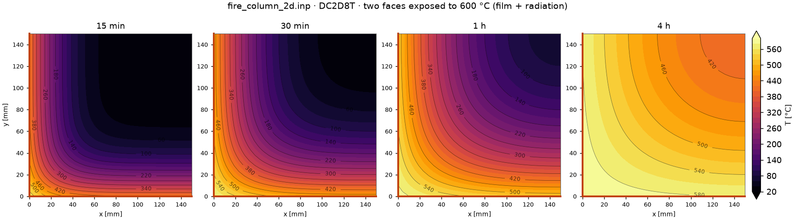
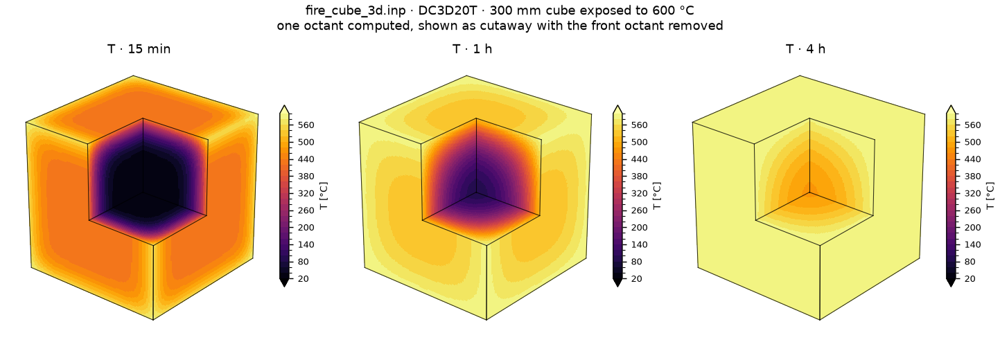
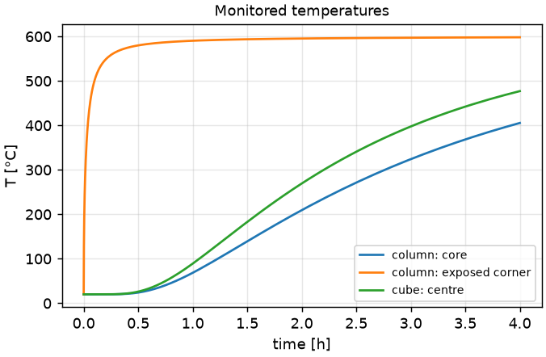
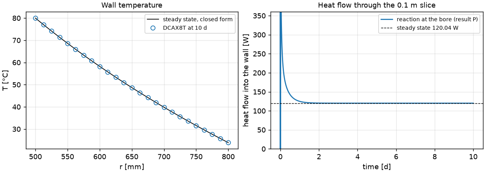

# Heat transfer with the Marmot transport elements

Transient heat conduction in concrete with the Marmot elements `DC*T` and the material `HeatConduction`. Three
models show the element families (plane, solid, axisymmetric) and all the heat loads:

| File | Element | What it shows |
|---|---|---|
| `fire_column_2d.inp` | `DC2D8T`, 16 × 16 | Fire exposure of a 300 × 300 mm column (one quarter): **heat film** and **heat radiation** to 600 °C, temperature-dependent conductivity and capacity |
| `fire_cube_3d.inp` | `DC3D20T`, 12³ | The same exposure on a 300 mm cube (one octant), from all six faces |
| `heated_pipe_axisymmetric.inp` | `DCAX8T`, 12 × 1 | A thick-walled pipe with hot water: **prescribed temperature** (Dirichlet) at the bore, **heat film** outside; transient up to steady state, checked against the closed form; heat flow as the **reaction** `P` |

All models start from a uniform temperature set with `setfield`. The film and radiation loads take their full value at
once with `f(t)='1'`. Units are m, s, kg and °C.

## Requirements

EdelweissFE built with its Marmot extensions, against a Marmot build that contains the transport elements and
`HeatConduction` (both are part of the public Marmot repository).

## Running

```bash
export OMP_NUM_THREADS=4
edelweissfe fire_column_2d.inp              # about 5 s
edelweissfe fire_cube_3d.inp                # about 1 min
edelweissfe heated_pipe_axisymmetric.inp    # under 1 s
```

Each run prints the monitored temperatures after every increment and writes Ensight output (`*.case`) for ParaView.

## Results

**Fire column and cube.** The exposed corner of the column is at 558 °C after 15 min and 598 °C after 4 h. The core
lags behind: 68 °C after 1 h and 405 °C after 4 h. In the cube, heated from six faces instead of four, the centre is at
89 °C after 1 h and 477 °C after 4 h.







**Heated pipe.** After 10 days the wall is at steady state. The steady temperature and heat flow have the closed form

$$T(r) = T_i - (T_i - T_\infty)\,\frac{\ln(r/r_i)}{\ln(r_o/r_i) + k/(h\,r_o)}, \qquad
Q = \frac{2\pi H k\,(T_i - T_\infty)}{\ln(r_o/r_i) + k/(h\,r_o)},$$

which gives $T(r_o) = 23.880$ °C and $Q = 120.036$ W for the 0.1 m slice. The model gives the same values: the
largest nodal deviation from $T(r)$ is 4e-6 K, and the reaction at the bore is 120.036 W.



## Notes

- A Dirichlet value is the *change* of the field over the step (here +60 K, from 20 to 80 °C), applied with the
  amplitude of the step (linear by default). Distributed loads take their value at once with `f(t)='1'`.
- A load keeps its value in later steps until it is redefined with the same `name`.
- Radiation needs the absolute zero of the temperature scale as its third value (−273.15 for °C).
