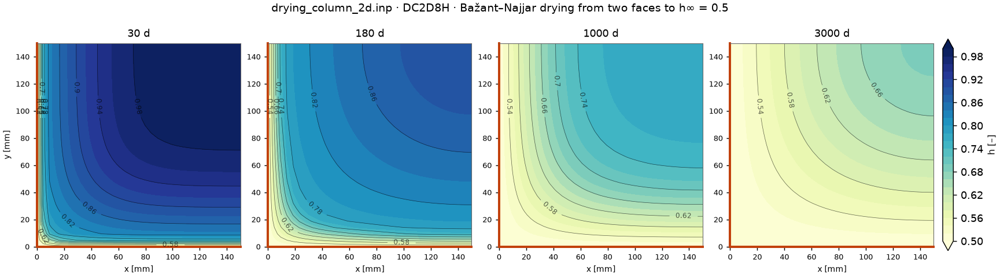
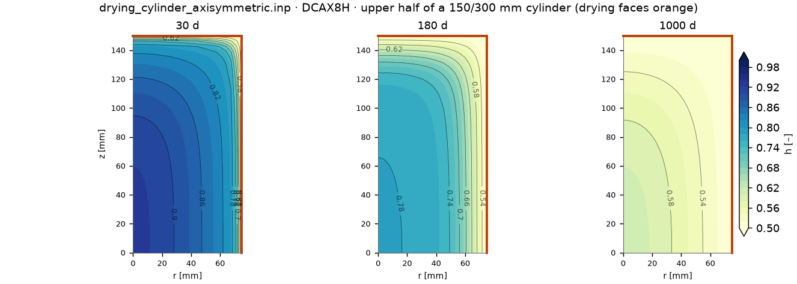
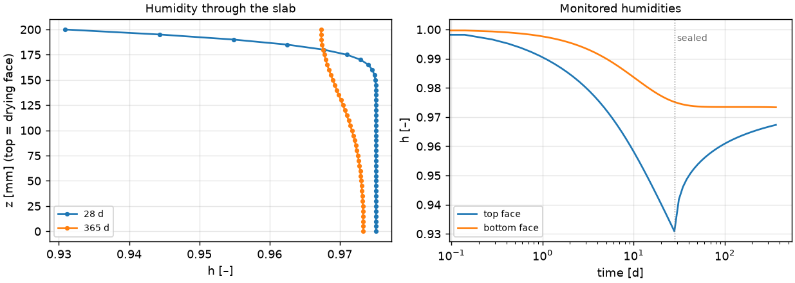

# Moisture diffusion in concrete with the Marmot transport elements

Drying and self-desiccation of concrete with the Marmot elements `DC*H` (field `relative humidity`) and the
material `MoistureDiffusion` (Bažant–Najjar diffusivity, linear or BSB sorption isotherm, optional self-desiccation):

| File | Element | What it shows |
|---|---|---|
| `drying_column_2d.inp` | `DC2D8H`, 16 × 16 | Drying of a 300 × 300 mm column (one quarter) to 50 % RH over 8 years: **moisture film**, classical Bažant–Najjar form (units mm and days) |
| `drying_cylinder_axisymmetric.inp` | `DCAX8H`, 10 × 20 | A standard 150/300 mm cylinder drying from its mantle and top face |
| `curing_slab_self_desiccation.inp` | `DC3D20H`, 1 × 1 × 20 | A young slab: **moisture flux** (evaporation through a curing compound) for 28 days, then sealed; **BSB isotherm** and **self-desiccation**; a load switched off in a later step |

The initial humidity is set with `setfield`. The film coefficient and the ambient humidity of a moisture film take
their full value at once with `f(t)='1'`.

## Requirements

EdelweissFE built with its Marmot extensions, against a Marmot build that contains the transport elements and
`MoistureDiffusion`.

## Running

```bash
export OMP_NUM_THREADS=4
edelweissfe drying_column_2d.inp                 # about 5 s
edelweissfe drying_cylinder_axisymmetric.inp     # about 3 s
edelweissfe curing_slab_self_desiccation.inp     # under 1 s
```

Each run prints the monitored humidities after every increment and writes Ensight output for ParaView.

## Results

**Column.** The diffusivity falls by a factor of 20 between $h = 1$ and $h \approx 0.6$, so a dry skin forms at
the surface while the core stays wet. The core is at $h = 0.895$ after 180 days, 0.775 after 1000 days and still
0.685 after 3000 days.



**Cylinder.** The centre of the specimen is at $h = 0.924$ after 30 days, 0.782 after 180 days and 0.609 after
1000 days. The figure shows the upper half; the drying faces are drawn in orange.



**Curing slab.** The hydration consumes water, so the humidity drops also at the sealed bottom face, to 0.975 at
28 days and 0.973 at 1 year. At the top, the evaporation lowers $h$ to 0.931 by day 28. After sealing, moisture
redistributes from the interior and the top recovers to 0.967.



## Notes

- **Units.** In the classical form (linear isotherm, unit capacity) $h$ itself diffuses: $D$ is in mm²/day and the
  film coefficient in mm/day. With the BSB isotherm the water content $w$ (kg/m³) is the conserved quantity, so $D$
  is in kg/(m·day) and fluxes are in kg/(m²·day).
- **Convergence floor.** The field `relative humidity` has an absolute flux floor of 1e-14. Where element fluxes
  nearly cancel (sealed regions, self-desiccation), set a floor that fits the units, as in
  `curing_slab_self_desiccation.inp` (`*updateConfiguration, configuration=absoluteFluxResidualTolerance`).
- **A prescribed flux is not limited by the water available.** With too large a rate the surface dries below
  $h = 0$. Where the environment controls drying, use a moisture film instead.
- **Switching a load off.** A redefined load ramps from its value at the start of the step to the new one by
  `f(t)`. `magnitude=0.0, f(t)='1'` removes it at once; `f(t)='0'` would keep it unchanged.
