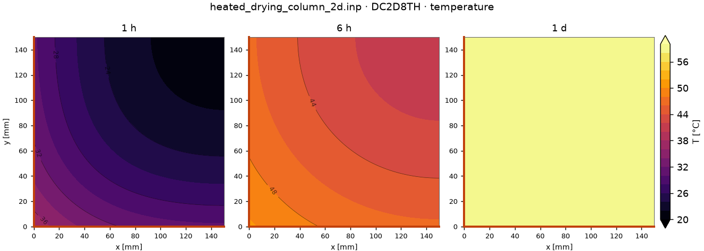
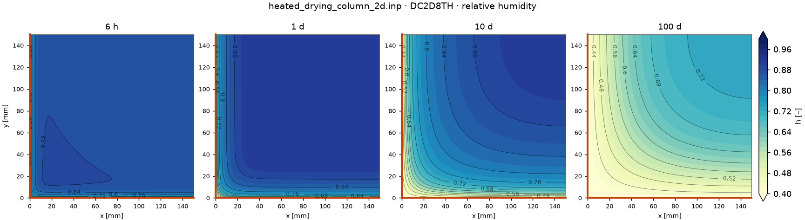
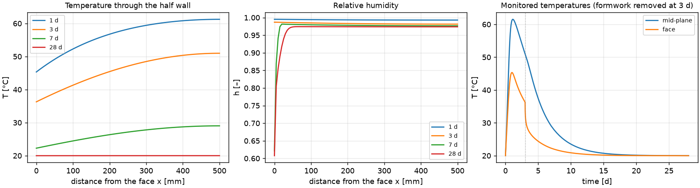
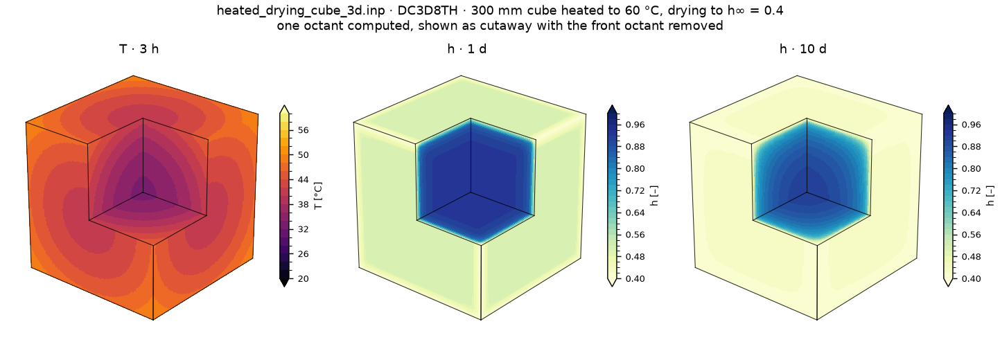

# Coupled heat and moisture transport in concrete

Heat and moisture transport with all couplings, using the Marmot elements `DC*TH` and the material `ThermoHygro`. Each
node carries the two fields `temperature` and `relative humidity`.

| File | Element | What it shows |
|---|---|---|
| `heated_drying_column_2d.inp` | `DC2D8TH`, 48 × 48 | A 300 × 300 mm column (one quarter) heated to 60 °C in dry air: **heat film**, **moisture film** and **latent heat film**; all transport couplings (Arrhenius diffusivity, hygrothermic coefficient, vapour pressure driving, heat capacity of the water, moisture dependent conductivity, latent heat carried by the vapour) |
| `early_age_wall_2d.inp` | `DC2D4TH`, 100 × 1 | A 1 m thick wall in its first 28 days: **heat of hydration** and **self-desiccation** over the equivalent (maturity) age; formwork removed after 3 days (loads changed and added in a later step) |
| `heated_drying_cube_3d.inp` | `DC3D8TH`, 16³ | The heated drying of the column, on a 300 mm cube (one octant) |

The property list is commented in each deck: heat (11 values), moisture (10), couplings (11). With the first 21
values only, `ThermoHygro` reproduces `HeatConduction` and `MoistureDiffusion` exactly. The coupling values are
illustrative. Units are m, s, kg and °C.

## Requirements

EdelweissFE built with its Marmot extensions, against a Marmot build that contains the transport elements and
`ThermoHygro`.

## Running

```bash
export OMP_NUM_THREADS=4
edelweissfe early_age_wall_2d.inp         # about 3 s
edelweissfe heated_drying_cube_3d.inp     # about 1 min
edelweissfe heated_drying_column_2d.inp   # about 1 min
```

## Results

**Heated drying column.** The section heats up within a day: the core is at 21.0 °C after 1 h, 40.9 °C after 6 h
and 58.4 °C after 1 day. While the core heats up, its humidity *rises*, from 0.80 to a peak of 0.922 after 3.8 days. The
water content hardly changes, but the isotherm shifts with temperature (hygrothermic coefficient). Only then does
drying take over: the core is at 0.737 after 100 days.





**Early-age wall.** The hydration heat (adiabatic rise 50 K) heats the mid-plane to a peak of 61.5 °C after
1.1 days, and the face to 45.3 °C. The wall cools in the formwork, and faster once it is removed at day 3. Until then
the wall is sealed and self-desiccation lowers the humidity uniformly to 0.98. After the formwork is removed, the face
dries towards 0.6.



**Heated drying cube.** The centre heats up faster than in the column (heated from six faces instead of four). Its
humidity likewise peaks at 0.922 and is at 0.912 after 10 days.



## Notes

- **Mesh near drying faces.** In the first hours the drying skin is only a few millimetres thick. The discrete
  solution is not bounded by $h_\infty$ (no discrete maximum principle; worst for 20-node elements at corners), so
  refine towards the exposed faces where surface values matter:
  - On 16 × 16 quadratic elements the column dips to 0.37 at the surface (ambient 0.4); on 48 × 48 it does not.
  - The cube with 8-node hexahedra dips to 0.398 at its corner after 1 day.
  - The wall needs 5 mm elements: with 20 mm ones the node next to the face overshoots to 1.02 when drying starts.
- **No saturated branch.** The humidity is not capped at 1. In the early-age wall the hygrothermic coefficient
  $\kappa$ is set to 0: with $\kappa = 0.003$ the 40 K temperature rise of the sealed, saturated concrete would push
  $h$ to about 1.1.
- **Latent heat film.** The latent heat film takes $c = L_v\beta$, the latent heat times the coefficient of the
  moisture film on the same face: 2.45e6 J/kg × 1.157e-5 kg/(m²s) = 28.36 W/m².
- **Convergence floors.** A sealed body with sources, like the early-age wall in its formwork, needs absolute flux
  floors for both fields that fit the units (`*updateConfiguration, configuration=absoluteFluxResidualTolerance`).
